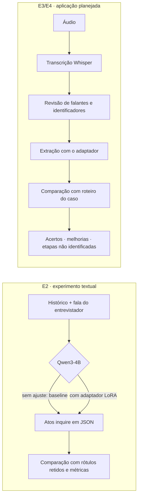

# Motor de IA para feedback educacional de anamnese

Projeto aplicado da disciplina **Tópicos Avançados em Inteligência Artificial** — 2026.2 · Prof. Marcondes Ricarte

| Grupo | Integrantes |
|---|---|
| GXX <!-- TODO: número do grupo --> | Leonardo Marcelo (@LeonardoMarcelo), André Lucas (@andredutradev) |

**Etapa atual:** E1 · Definição (só documentação). Documento completo: [`docs/E1-definicao.md`](docs/E1-definicao.md) · [PDF](docs/E1-definicao.pdf).

> **Em uma frase:** um modelo de linguagem pré-treinado (Qwen3-4B-Instruct-2507), ajustado com LoRA sobre o corpus
> MediTOD, identifica quais perguntas o estudante de medicina fez numa anamnese simulada, para gerar feedback
> educacional verificável. **Não diagnostica, não prescreve e não recomenda conduta.**

| Ficha rápida | |
|---|---|
| Cliente | Marília Costa, docente de medicina (preceptoria em ambulatório universitário) |
| Usuário principal | Estudante de medicina que pratica anamnese; preceptor como beneficiário indireto |
| Artigo-base | Saley et al. (2024). *MediTOD*. EMNLP. [doi:10.18653/v1/2024.emnlp-main.936](https://doi.org/10.18653/v1/2024.emnlp-main.936) |
| Modelo | [Qwen3-4B-Instruct-2507](https://huggingface.co/Qwen/Qwen3-4B-Instruct-2507) (Apache-2.0), LoRA sobre pesos 4-bit em MLX |
| Dados | MediTOD `raw_data/` (diálogos + anotações CMAS) · Fareez et al. (2022), CC0, para áudio futuro |
| Baseline | Mesmo Qwen sem adaptador (+ regras simples, se executadas) |
| Métricas | Precisão, recall e F1 micro dos rótulos `inquire`; validade de JSON; perda; latência e memória |

## Cliente, problema e beneficiário

**Contexto.** Marília Costa descreve um problema da preceptoria em ambulatório universitário: um docente precisa
acompanhar vários estudantes e, ao mesmo tempo, atender à demanda assistencial. A observação da entrevista e o
feedback individual dependem da disponibilidade do preceptor. O estudante pode terminar uma atividade sem saber
quais partes da investigação deixou de realizar.

**Quem se beneficia.** O usuário principal é o estudante de medicina que pratica anamnese. O preceptor é
beneficiário indireto: poderá consultar um registro das perguntas e revisar o feedback antes de usá-lo no ensino.
A proposta parte de uma cliente real; não pressupõe parceria institucional, contratação ou aceite formal da solução.

**Como é resolvido hoje e o que a aplicação muda:**

| Processo atual | Limitação relevante | Benefício pretendido |
|---|---|---|
| Observação direta e comentários do preceptor | Dependem da presença e do tempo disponível | Organizar evidências da entrevista para facilitar a revisão |
| Autoavaliação do estudante | Pode divergir da avaliação externa | Mostrar trechos concretos que sustentam o retorno |
| Avaliações práticas em momentos específicos | Não acompanham necessariamente cada treino | Permitir revisão de entrevistas simuladas entre avaliações |

**Problema específico:** a dificuldade de obter um registro **frequente e verificável** das etapas de investigação
realizadas pelo estudante. A hipótese de benefício é que esse registro ajude a orientar a prática seguinte. Ganho de
aprendizagem, redução da carga do preceptor e satisfação do usuário são objetivos futuros, não resultados demonstrados.

**Evidência inicial.** Relato escrito *"Motor de IA especializado em educação médica: o problema e as
características da solução"*, de Marília Costa, transcrito em [`evidencias/relato_cliente.md`](evidencias/relato_cliente.md).
Ele descreve a necessidade, o fluxo desejado e as qualidades esperadas do feedback. É um relato documental: não é
uma entrevista conduzida pela dupla nem uma observação independente do ambulatório.

A literatura situa o problema sem medir o processo específico da cliente: Haring et al. (2017) sobre raciocínio
clínico observável na anamnese; Spencer (2003) sobre ensino no ambiente clínico; Cheung et al. (2019) e Alex et al.
(2024) sobre barreiras à observação direta. Sobre autoavaliação, Blanch-Hartigan (2011) encontrou capacidade
**moderada** em estudantes. Por isso o feedback externo é tratado como complemento verificável à reflexão do aluno,
e não como prova de que o estudante avalia mal o próprio desempenho.

**Limites da evidência:** não há entrevista agendada, consentimento assinado nem validação clínica nos materiais
recebidos. Uma conversa com a cliente e a revisão do roteiro estão planejadas para as próximas etapas.

## Solução e escopo

**Entrada (E2, experimento textual):** histórico recente e fala atual do entrevistador num diálogo simulado, com o
falante já identificado pelo corpus.
**Saída:** lista JSON de atos `inquire` (categoria, valor e atributos investigados).
**Aplicação planejada (E3/E4):** transcrição identificada por falante ou áudio de anamnese simulada. O áudio passa por
transcrição local e **revisão humana dos falantes** antes da análise. O Whisper, sozinho, não diz com segurança quem é
estudante ou paciente, então a diarização não é tratada como pronta.



Cada afirmação do feedback futuro deverá apontar o trecho da entrevista que a sustenta. A comparação com o roteiro é
determinística, mas recebe a saída de um modelo sujeito a erro. Por isso, **saída inválida, transcrição de baixa
confiança ou falantes não revisados geram "avaliação inconclusiva"**, nunca "o estudante não perguntou".

**Exemplo ilustrativo (não é resultado medido).** Pergunta: *"Quando a tosse começou?"*

```json
[{ "slot": "symptom", "value": "cough", "attributes": ["when check"] }]
```

Isso sustenta um retorno como: *"Você investigou o início da tosse. Na próxima prática, revise os demais aspectos
previstos no roteiro do caso."* Não permite afirmar que a anamnese está completa, que o paciente tem uma doença ou que
um procedimento é indicado. A equivalência entre perguntas em português e rótulos em inglês ainda precisa ser avaliada.

| Será implementado até a apresentação | Não será implementado |
|---|---|
| E1: problema, artigo, modelo, dados e plano (este PR) | Diagnóstico, tratamento ou apoio à decisão clínica |
| E2: preparo reproduzível do texto, partições, baseline, primeiro LoRA, logs e métricas | Uso com pacientes reais ou dados de prontuário |
| E3: extração integrada ao fluxo de uso, rastreabilidade por trecho, comparação com roteiro | Treinamento do zero |
| E4: demonstração de um caso completo e defesa técnica | Implantação multiusuário ou validação de eficácia educacional em larga escala |

Primeiro recorte: entrevistas simuladas predominantemente **respiratórias** (perfil do corpus).

## Artigo-base

- **Título:** MediTOD: An English Dialogue Dataset for Medical History Taking with Comprehensive Annotations
- **Autores:** Vishal Vivek Saley, Goonjan Saha, Rocktim Jyoti Das, Dinesh Raghu e Mausam
- **Ano:** 2024 (EMNLP 2024, p. 16843–16877)
- **DOI/URL:** <https://doi.org/10.18653/v1/2024.emnlp-main.936> · [ACL Anthology](https://aclanthology.org/2024.emnlp-main.936/) · código e dados: <https://github.com/dair-iitd/MediTOD>
- **Componentes utilizados/adaptados:** esquema de anotação CMAS e ajuste supervisionado de um LLM pré-treinado para emitir estrutura (detalhes abaixo)

**Método do artigo.** O MediTOD reúne diálogos de coleta de história clínica anotados com o *Comprehensive Medical
Attribute Schema* (CMAS). A anotação separa atos como `inquire` (pergunta) e `inform` (informação) e liga cada fala a
categorias (sintoma, antecedentes, medicação, hábitos…) e atributos (início, duração, intensidade…). O artigo avalia
compreensão (NLU), política de diálogo e geração, com modelos ajustados por supervisão. Na NLU, que olha a fala mais
recente do **paciente**, o Llama3-8B supervisionado chega a F1 0,7139.

**O que muda aqui.** Nosso projeto extrai atos `inquire` das falas já proferidas pelo **entrevistador**, com outra
divisão dos dados e outra correspondência entre rótulos. Não é uma reprodução da NLU original, e os números do artigo
**não serão comparados diretamente** aos nossos.

| Componente do artigo | Uso no projeto | Mudança ou limite |
|---|---|---|
| Esquema CMAS | Categorias e atributos da extração | Foco retrospectivo em `inquire` |
| Falas e anotações textuais abertas (`raw_data/`) | Preparação local e experimento inicial | Licença das anotações não identificada; sem redistribuição |
| Ajuste supervisionado de modelo pré-treinado | Aprender a emitir estrutura a partir do contexto | Qwen 4B + LoRA em hardware local, no lugar do Llama3-8B |
| Avaliação publicada | Referência de desenho experimental | Métricas próprias explícitas, sem alegar equivalência numérica |
| Política e geração de perguntas | Não utilizadas | O sistema não entrevista no lugar do aluno |
| Canonicalização UMLS | Não utilizada | Evita depender de licença UMLS (exigida para o conjunto canonicalizado) |

O código de métricas original (`metrics/nlu_metrics.py`) não será copiado: ele inclui canonicalização e
correspondência que não equivalem à nossa avaliação por conjuntos de rótulos. A correspondência metodológica está em
usar **contexto de diálogo + supervisão estruturada + modelo pré-treinado adaptado**, não em manter a tarefa inteira.

**Referências de apoio ao método:** Hu et al. (2022) — LoRA; Dettmers et al. (2023) — QLoRA, adaptação sobre
modelos quantizados (o MLX usa LoRA sobre pesos 4-bit; não presumimos equivalência exata ao NF4 do QLoRA);
Van Veen et al. (2024) — LLMs adaptados no domínio clínico e avaliação humana em dimensões separadas.

## Modelo pré-treinado

- **Nome e versão:** Qwen3-4B-Instruct-2507 (revisão consultada em 12/11/2026: `cdbee75`)
- **Origem dos pesos:** <https://huggingface.co/Qwen/Qwen3-4B-Instruct-2507> · distribuição para execução local em MLX: <https://huggingface.co/mlx-community/Qwen3-4B-Instruct-2507-4bit> (revisão `50d4277`)
- **Licença:** Apache-2.0 (as duas fichas)
- **Tarefa original:** geração de texto e seguimento de instruções, multilíngue
- **Tarefa adaptada:** contexto + pergunta do entrevistador → lista de atos `inquire` em JSON
- **Parâmetros ajustados:** matrizes LoRA em parte das camadas; pesos-base congelados
- **Relação com o artigo-base:** o artigo usa Llama3-8B. Trocamos por um modelo de 4B para caber em 16 GiB de memória
  unificada, mantendo a mesma formulação (geração supervisionada de estrutura a partir do diálogo). O suporte
  multilíngue do Qwen torna o português **uma hipótese a testar**, não uma qualidade comprovada após ajuste em inglês.
  Plano B, se o professor pedir redução de escopo: Qwen3-1.7B com a mesma receita (ver [`docs/decisoes.md`](docs/decisoes.md)).

**Componente de áudio (E3/E4, sem ajuste):** [Whisper large-v3-turbo](https://huggingface.co/openai/whisper-large-v3-turbo),
licença MIT. Fora da avaliação da E2; qualidade em português e custo serão medidos quando houver áudio de teste.

Ficha completa no contexto do projeto: [`docs/model_card.md`](docs/model_card.md).

## Conjunto de dados-base

- **Fonte e acesso:** <!-- link + como obter -->
- **Licença/autorização:**
- **Formato e volume:**
- **Rótulos e adequação ao problema:**

> Arquivos de dados grandes **não** devem ser versionados no repositório.
> Use este espaço para o link (Google Drive, Hugging Face, etc.) e as instruções de download.

## Plano de adaptação e avaliação

- **O que será ajustado:** <!-- full fine-tuning, parcial ou adaptadores (LoRA etc.) -->
- **Recursos computacionais:** <!-- GPU/Colab/Kaggle, tempo estimado -->
- **Baseline:**
- **Métricas:**
- **Riscos:**
- **Divisão das atividades entre os integrantes:**

## Como executar

```bash
# 1. Criar ambiente
python -m venv .venv && source .venv/bin/activate  # Windows: .venv\Scripts\activate
pip install -r requirements.txt

# 2. (Se aplicável) baixar dados e pesos conforme as seções acima

# 3. Executar
# python src/train.py ...
# python src/app.py ...
```

## Resultados

<!-- Preencher a partir da E2: baseline, configuração do ajuste, métricas,
exemplos de sucesso e falha, comparação final. Detalhes em docs/experimentos.md -->

## Limitações e uso responsável

<!-- Limitações conhecidas, anonimização de dados sensíveis, cuidados de uso,
custo/latência quando relevante -->

## Referências

<!-- Artigo-base e demais referências citadas (formato ABNT ou APA) -->
