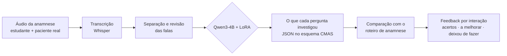

# Motor de IA para feedback educacional de anamnese

Projeto aplicado da disciplina **Tópicos Avançados em Inteligência Artificial** — 2026.2 · Prof. Marcondes Ricarte

| Grupo | Integrantes |
|---|---|
| G04 | Leonardo Marcelo (@LeonardoMarcelo), André Lucas (@andredutradev) |

**Etapa atual:** E2 · Dados preparados e primeira adaptação. Relatório: [`docs/E2-modelo-dados.md`](docs/E2-modelo-dados.md) · [PDF](docs/E2-modelo-dados.pdf).
Definição do projeto (E1): [`docs/E1-definicao.md`](docs/E1-definicao.md) · [PDF](docs/E1-definicao.pdf).

> **Em uma frase:** a partir do áudio da anamnese que o estudante de medicina faz com um paciente real, o sistema
> transcreve a entrevista, identifica o que cada pergunta do estudante investigou (Qwen3-4B-Instruct-2507 ajustado com
> LoRA sobre o corpus MediTOD) e devolve um feedback sobre cada interação, com o que ele acertou, o que precisa melhorar
> e o que deixou de investigar. **Não diagnostica, não prescreve e não recomenda conduta.**

| Ficha rápida | |
|---|---|
| Cliente | Marília Costa, docente de medicina (semiologia, ambulatório universitário) |
| Usuário principal | Estudante de medicina que faz anamnese com paciente real; professor como beneficiário indireto |
| Entrada | Áudio da anamnese conduzida pelo estudante com um paciente real |
| Saída | Feedback sobre cada interação e pergunta + resumo: acertos, o que errou ou precisa melhorar, o que deixou de fazer |
| Artigo-base | Saley et al. (2024). *MediTOD*. EMNLP. [doi:10.18653/v1/2024.emnlp-main.936](https://doi.org/10.18653/v1/2024.emnlp-main.936) |
| Modelo | [Qwen3-4B-Instruct-2507](https://huggingface.co/Qwen/Qwen3-4B-Instruct-2507) (Apache-2.0), LoRA sobre pesos 4-bit em MLX · Whisper large-v3-turbo (MIT) na transcrição, sem ajuste |
| Dados | MediTOD `raw_data/` (diálogos + anotações CMAS) · Fareez et al. (2022), CC0, áudios simulados · versão em português por tradução (hipótese) |
| Baseline | Mesmo Qwen sem adaptador (+ regras simples, se executadas) |
| Métricas | Precisão, recall e F1 dos rótulos `inquire` (inglês e português traduzido); validade de JSON; latência e memória |

## Cliente, problema e beneficiário

### Cliente e contexto

Marília Costa é docente de medicina. Na disciplina de semiologia, os estudantes vão ao ambulatório universitário
atender pacientes reais e fazem a anamnese: a entrevista em que, a partir da queixa principal ("o que te trouxe
aqui?"), investigam a história do paciente. É uma habilidade investigativa, desenvolvida com prática e retorno. O
exame físico, que vem depois da anamnese, não faz parte deste projeto. A cliente é real; o projeto não pressupõe
parceria institucional, contratação ou aceite formal da solução.

### Necessidade

O ideal, segundo a cliente, é o professor acompanhar a entrevista e dizer ao estudante o que ele acertou, o que errou e
o que deixou de fazer, para que ele corrija na próxima. Isso não acontece de forma adequada: um professor responde por
mais de vinte alunos, além da rotina do consultório, e não consegue ver o que cada um faz nem dar esse retorno
individual. Quando o retorno existe, é verbal, pouco consistente e tardio.

| Processo atual | Limitação relevante | Benefício pretendido |
|---|---|---|
| Professor observa e comenta a entrevista | Um professor para mais de vinte alunos; depende da presença e do tempo | Feedback para cada anamnese gravada, não só para as que o professor acompanha |
| Autoavaliação do estudante | Pode divergir da avaliação externa | Mostrar os trechos da entrevista que sustentam cada observação |
| Avaliações práticas pontuais | Não acompanham cada atendimento | Retorno logo após a anamnese, a tempo da próxima |

**Problema específico:** o estudante termina a anamnese sem um retorno individual e verificável sobre o que investigou
e o que deixou de investigar. A hipótese de benefício é que esse retorno ajude a melhorar a entrevista seguinte. Ganho
de aprendizagem e redução da carga do professor são objetivos, não resultados demonstrados.

### Perfil do usuário

- **Usuário principal:** estudante de medicina em formação clínica, cursando semiologia, que conduz anamneses com
  pacientes reais no ambulatório e precisa saber o que investigou bem e o que deixou de investigar.
- **Beneficiário indireto:** o professor (preceptor), que pode consultar o registro e revisar o feedback antes de
  usá-lo no ensino.

### Evidência inicial

Entrevista com a cliente por mensagens de voz e vídeo explicativo enviado por ela, registrados em
[`evidencias/entrevista_cliente.md`](evidencias/entrevista_cliente.md). A cliente descreve o cenário (ambulatório,
paciente real, semiologia), o feedback esperado (acertos, erros e o que deixou de fazer), a causa do problema (um
professor para mais de vinte alunos, com retorno pouco consistente e tardio) e a solução que imagina: captar o áudio da
entrevista, transformá-lo em texto e analisá-lo com os conhecimentos de anamnese.

A literatura situa o problema sem medir o caso da cliente: Haring et al. (2017) sobre raciocínio clínico observável na
anamnese; Spencer (2003) sobre ensino no ambiente clínico; Cheung et al. (2019) e Alex et al. (2024) sobre barreiras à
observação direta; Bastos e Castro et al. (2021) sobre o efeito do feedback no aprendizado de estudantes de medicina.
Sobre autoavaliação, Blanch-Hartigan (2011) encontrou capacidade **moderada** em estudantes, e Davis et al. (2006)
analisaram médicos, não estudantes. Por isso o feedback externo é tratado como complemento verificável à reflexão do
aluno, e não como prova de que o estudante avalia mal o próprio desempenho. Sobre o uso de IA no ensino, Gordon et al.
(2024) mapeiam aplicações na educação médica, e Varughese et al. (2026) revisam a percepção de estudantes sobre IA na
prática médica.

**Limites da evidência:** é a visão de uma docente; a dupla não observou o ambulatório, e o roteiro de itens que o
feedback vai cobrar ainda precisa ser validado com a cliente.

## Solução e escopo

### Por que esta solução

A solução combina as três bases que o projeto pede:

| Base | O que ela indica | Decisão de projeto |
|---|---|---|
| Necessidade da cliente | O estudante precisa saber o que acertou, errou e deixou de fazer; o professor não acompanha todos | Feedback automático para cada anamnese, revisável pelo professor |
| Evidência do processo atual | A anamnese é uma entrevista investigativa, conduzida por perguntas, que pode ser gravada em áudio | A entrada é o áudio, e a unidade de análise é cada pergunta do estudante |
| Artigo-base (MediTOD) | As perguntas de uma anamnese podem ser representadas por atos `inquire` com categoria e atributos (CMAS), e um LLM ajustado por supervisão aprende a extraí-los | "O que cada pergunta investigou" vira uma extração mensurável; o feedback vem da comparação com um roteiro, não de texto livre do modelo |

### Entrada

Gravação de áudio da anamnese conduzida pelo estudante com um paciente real (só a entrevista, sem o exame físico).

### Saída

Feedback ao estudante, em português, em duas partes:

1. **Avaliação de cada interação.** Para cada pergunta do estudante: o trecho transcrito, o que ela investigou (por
   exemplo, o início da tosse) e como ficou cada item do roteiro tocado por ela (investigado, parcial, inconclusivo).
2. **Resumo da anamnese**, nos três blocos pedidos pela cliente: o que o estudante **acertou** (itens do roteiro
   investigados), o que **errou ou precisa melhorar** (itens abordados sem a caracterização esperada, como perguntar pela
   tosse sem investigar início, duração ou fatores de piora) e o que **deixou de fazer** (itens do roteiro sem nenhuma
   pergunta identificada).

Cada observação aponta o trecho da entrevista que a sustenta. Saída inválida do modelo, transcrição de baixa confiança
ou falantes não revisados geram **"avaliação inconclusiva"**, nunca "o estudante não perguntou".

### Fluxo de uso

1. O estudante grava a anamnese no ambulatório, com consentimento do paciente.
2. O áudio é transcrito localmente pelo Whisper.
3. As falas são separadas entre estudante e paciente, e o estudante ou o professor confirma quem falou o quê.
4. Para cada fala do estudante, o modelo ajustado (Qwen3-4B + LoRA) lista em JSON o que foi investigado: categoria,
   valor e atributos do CMAS.
5. Uma comparação determinística com o roteiro de anamnese do caso classifica cada item.
6. O sistema monta o feedback por interação e o resumo. O professor pode revisar antes de liberar ao estudante.



### Do rótulo ao feedback

O roteiro de cada caso segue a anamnese ensinada em semiologia e escolhe quais itens do CMAS são pertinentes; a
frequência de um item no corpus não o torna obrigatório. O mapeamento abaixo é uma proposta da dupla, ainda sem
validação da cliente.

| Categoria CMAS | Item do roteiro de anamnese |
|---|---|
| `symptom` e atributos | Queixa principal, caracterização dos sintomas (início, duração, intensidade…) e outros sintomas previstos no caso |
| `medical history` | Antecedentes pessoais |
| `medication` | Medicamentos relatados ou em uso |
| `habit` | Hábitos pertinentes ao caso |
| `family history` | História familiar |
| `occupation`, `exposure`, `travel` | Contexto ocupacional, ambiental e de deslocamentos, quando pertinente |

Cada item pode sair como: investigação identificada · parcial · não identificada · informação espontânea presente ·
não aplicável · **avaliação inconclusiva**. Alergias, vacinação e revisão completa de sistemas não têm categoria
própria no CMAS, então o sistema não poderá dizer que avalia a anamnese inteira.

**Exemplo ilustrativo (não é resultado medido).** Pergunta do estudante: *"Quando a tosse começou?"*

```json
[{ "slot": "symptom", "value": "cough", "attributes": ["when check"] }]
```

Feedback da interação: *"Nesta pergunta você investigou o início da tosse. O roteiro do caso também prevê duração e
fatores de piora, que não apareceram na entrevista."* Os rótulos ficam no vocabulário do CMAS, em inglês, e o feedback
os traduz para os termos do roteiro em português. O exemplo não permite afirmar que a anamnese está completa, que o
paciente tem uma doença ou que um procedimento é indicado.

### O que será e o que não será implementado

| Será implementado até a apresentação | Não será implementado |
|---|---|
| Preparo dos dados do MediTOD, baseline e ajuste LoRA do extrator de perguntas | Avaliação do exame físico |
| Versão em português dos dados por tradução, para medir e reduzir a perda no idioma (hipótese) | Diagnóstico, hipótese diagnóstica, tratamento ou apoio à decisão clínica |
| Transcrição local do áudio (Whisper, sem ajuste) com revisão de quem falou | Separação automática e confiável de falantes (diarização) |
| Extração do que cada pergunta investigou e comparação com um roteiro de anamnese | Treinamento do zero ou ajuste do Whisper |
| Feedback por interação e resumo (acertos, a melhorar, deixou de fazer), com trechos | Integração com prontuário, implantação multiusuário ou validação de eficácia educacional em larga escala |
| Demonstração do fluxo completo com uma anamnese simulada | Painel da turma para o professor e histórico do aluno ao longo do curso |

O desenvolvimento e a demonstração usam áudios de entrevistas simuladas (Fareez et al., 2022, CC0), para não expor
pacientes. Gravações com pacientes reais só entram com consentimento do paciente e do estudante e autorização do
ambulatório. Primeiro recorte: queixas predominantemente **respiratórias** (perfil do corpus).

## Artigo-base

- **Título:** MediTOD: An English Dialogue Dataset for Medical History Taking with Comprehensive Annotations
- **Autores:** Vishal Vivek Saley, Goonjan Saha, Rocktim Jyoti Das, Dinesh Raghu e Mausam
- **Ano:** 2024 (EMNLP 2024, p. 16843–16877)
- **DOI/URL:** <https://doi.org/10.18653/v1/2024.emnlp-main.936> · [ACL Anthology](https://aclanthology.org/2024.emnlp-main.936/) · código e dados: <https://github.com/dair-iitd/MediTOD>
- **Componentes utilizados/adaptados:** esquema de anotação CMAS, diálogos anotados e ajuste supervisionado de um LLM pré-treinado para emitir estrutura (tabela abaixo)

### Método

O MediTOD reúne diálogos de coleta de história clínica anotados com o *Comprehensive Medical Attribute Schema* (CMAS).
A anotação separa atos como `inquire` (pergunta) e `inform` (informação) e liga cada fala a categorias (sintoma,
antecedentes, medicação, hábitos…) e atributos (início, duração, intensidade…). O artigo avalia compreensão (NLU),
política de diálogo e geração, com modelos ajustados por supervisão. Na NLU, que olha a fala mais recente do
**paciente**, o Llama3-8B supervisionado chega a F1 0,7139.

Nosso projeto extrai atos `inquire` das falas já proferidas pelo **entrevistador** (o estudante), com outra divisão dos
dados e outra correspondência entre rótulos. Não é uma reprodução da NLU original, e os números do artigo **não serão
comparados diretamente** aos nossos.

### Componentes utilizados ou adaptados

| Componente do artigo | Uso no projeto | Mudança ou limite |
|---|---|---|
| Esquema CMAS | Categorias e atributos do que cada pergunta investigou | Foco retrospectivo em `inquire` |
| Falas e anotações textuais abertas (`raw_data/`) | Preparação local e ajuste do extrator | Licença das anotações não identificada; sem redistribuição |
| Ajuste supervisionado de modelo pré-treinado | Aprender a emitir estrutura a partir do contexto | Qwen 4B + LoRA em hardware local, no lugar do Llama3-8B |
| Avaliação publicada | Referência de desenho experimental | Métricas próprias explícitas, sem alegar equivalência numérica |
| Política e geração de perguntas | Não utilizadas | O sistema não entrevista no lugar do aluno |
| Canonicalização UMLS | Não utilizada | Evita depender de licença UMLS (exigida para o conjunto canonicalizado) |

O código de métricas original (`metrics/nlu_metrics.py`) não será copiado: ele inclui canonicalização e
correspondência que não equivalem à nossa avaliação por conjuntos de rótulos.

**Referências de apoio ao método:** Hu et al. (2022) — LoRA; Dettmers et al. (2023) — QLoRA, adaptação sobre
modelos quantizados (o MLX usa LoRA sobre pesos 4-bit; não presumimos equivalência exata ao NF4 do QLoRA);
Van Veen et al. (2024) — LLMs adaptados no domínio clínico e avaliação humana em dimensões separadas.

## Modelo pré-treinado

- **Nome e versão:** Qwen3-4B-Instruct-2507 (revisão consultada em 12/11/2026: `cdbee75`)
- **Origem dos pesos:** <https://huggingface.co/Qwen/Qwen3-4B-Instruct-2507> · distribuição para execução local em MLX: <https://huggingface.co/mlx-community/Qwen3-4B-Instruct-2507-4bit> (revisão `50d4277`)
- **Licença:** Apache-2.0 (as duas fichas)
- **Tarefa original:** geração de texto e seguimento de instruções, multilíngue
- **Tarefa adaptada:** contexto + pergunta do estudante → lista de atos `inquire` em JSON
- **Relação com o artigo-base:** o artigo usa Llama3-8B. Trocamos por um modelo de 4B para caber em 16 GiB de memória
  unificada. A correspondência metodológica está mantida: um LLM pré-treinado, decoder-only e ajustado por instrução,
  recebe o contexto do diálogo e é ajustado por supervisão para gerar a estrutura CMAS. O suporte multilíngue do Qwen é
  o que torna viável a hipótese do português (ver [Conjunto de dados-base](#conjunto-de-dados-base)). Plano B, se o
  professor pedir redução de escopo: Qwen3-1.7B com a mesma receita (ver [`docs/decisoes.md`](docs/decisoes.md)).

**Componente de transcrição (usado sem ajuste):** [Whisper large-v3-turbo](https://huggingface.co/openai/whisper-large-v3-turbo),
licença MIT, tarefa original de reconhecimento de fala multilíngue (Radford et al., 2023). Transcreve o áudio da anamnese e não faz parte da
avaliação do extrator; sua qualidade na fala do ambulatório será medida em áudio de teste.

## Conjunto de dados-base

- **Fonte e acesso:** repositório público [dair-iitd/MediTOD](https://github.com/dair-iitd/MediTOD), arquivos
  `raw_data/dialogs.json` (~4,4 MB) e `raw_data/annotations.json` (~4,3 MB), revisão `0b7a87c` consultada em 12/11/2026.
  Os áudios vêm do [Figshare 16550013](https://springernature.figshare.com/articles/dataset/Collection_of_simulated_medical_exams/16550013)
  (Fareez et al., 2022).
- **Licença/autorização:** ⚠️ o repositório do MediTOD **não tem arquivo LICENSE** e não identificamos declaração de
  licença para as anotações. Os diálogos de origem vêm de Fareez et al. (2022), publicados como **CC0**, mas isso não
  define a licença das anotações. Por isso dados, traduções e adaptadores derivados ficam **só no ambiente local**, e a
  dupla vai pedir autorização aos autores antes de qualquer redistribuição.
- **Formato e volume:** MediTOD em JSON: cada diálogo tem falas com identificador, texto e falante; as anotações têm atos
  com `uid`, intenção, categoria, valor e atributos. Fareez: 272 entrevistas simuladas no formato OSCE, em inglês, com
  áudio mp3 e transcrição em texto (`Data.zip`, ~1,03 GB). Volume do MediTOD medido em 12/11/2026 (estatísticas
  agregadas, sem treino):

  | Medida | Valor |
  |---|---|
  | Diálogos (com anotação alinhada fala a fala) | **231** (100% alinhados) |
  | Falas | 22.317 (11.097 do médico · 10.989 do paciente · 231 de controle) |
  | Falas do médico com ≥ 1 ato `inquire` / sem `inquire` | 9.707 / 1.390 (as sem `inquire` viram amostras de lista vazia) |
  | Atos `inquire` | 10.082 em 13 categorias |
  | Categorias mais frequentes | `symptom` 5.527 · `medical history` 1.406 · `habit` 795 · `medication` 520 · `exposure` 488 · `family history` 457 |
  | Pares de diálogos com texto idêntico e ids diferentes | **18** → 213 grupos únicos para a divisão |

- **Rótulos e adequação ao problema:** os atos `inquire` marcam exatamente o que o entrevistador perguntou — o sinal de
  que o feedback por interação precisa. Informações espontâneas do paciente **não** provam que uma pergunta foi feita, e
  o sistema também não deve punir o estudante por não repetir algo já informado: presença de informação e evidência de
  investigação são conceitos separados.

### Representatividade do cenário e tradução para o português

Os dados públicos cobrem bem a tarefa (perguntas de anamnese com rótulos finos), mas não o idioma nem o contexto da
cliente: são entrevistas simuladas, em inglês, de estudantes canadenses. Como **hipótese para os próximos passos**, a base
será tratada com traduções para o português:

1. Traduzir para o português as falas dos diálogos do MediTOD, preservando o identificador e o alinhamento de cada
   fala. Os rótulos continuam no vocabulário do CMAS, em inglês, então a anotação vale para as duas versões.
2. Usar a tradução da **partição de teste** para medir quanto o extrator perde do inglês para o português nas mesmas
   amostras.
3. Testar se incluir a tradução do **treino** no ajuste LoRA reduz essa perda.
4. Revisar manualmente uma amostra das traduções, com atenção à terminologia médica e aos atributos investigados
   (início, duração, intensidade…), e registrar o método de tradução e a taxa de revisão.

Texto traduzido não reproduz a fala espontânea de um ambulatório brasileiro (coloquialismos, variação regional, ruído).
Por isso a tradução aproxima o cenário, mas não o substitui: a validação final pede gravações reais em português,
quando autorizadas.

| Fonte | Conteúdo e acesso | Licença ou condição | Papel |
|---|---|---|---|
| MediTOD `raw_data/` | JSON público no GitHub; 231 diálogos, 10.082 atos `inquire` | Sem LICENSE identificado | Treino e teste do extrator, em inglês |
| Tradução do MediTOD para o português | Gerada pela dupla, localmente | Derivada do MediTOD: não redistribuída | Medir e reduzir a perda em português (hipótese) |
| [Fareez et al. (2022)](https://doi.org/10.1038/s41597-022-01423-1) | 272 entrevistas simuladas com áudio mp3 e transcrição | CC0 | Testar e demonstrar o fluxo a partir do áudio sem expor pacientes |
| Gravações de anamneses com pacientes reais | Ainda não coletadas | Consentimento do paciente e do estudante, autorização do ambulatório e anonimização | Validar o fluxo no cenário da cliente, quando autorizadas |

### Preparação e divisão dos dados

Os arquivos de divisão publicados (`data/train_ids.json`, `valid_ids.json`, `test_ids.json`) têm **um único id cada**
(`115`, `317`, `407`) e não recuperam a divisão do artigo. Usaremos divisão própria, determinística e documentada por
**listas de diálogo**; diálogos textualmente idênticos com ids diferentes ficam no mesmo grupo, para que nenhuma
entrevista apareça em treino e teste ao mesmo tempo. Isso não é hipotético: há **18 pares** de diálogos idênticos (ex.:
`106`/`206`, `124`/`624`), que um sorteio por id espalharia entre as partições.

Como os diálogos do MediTOD vêm das entrevistas do Fareez, os áudios usados na demonstração e na avaliação do fluxo serão
**só os da partição de teste**; a correspondência entre os ids do MediTOD e os arquivos do Fareez será conferida na
preparação.

1. Fixar a revisão do repositório-fonte e registrar o SHA-256 dos arquivos baixados.
2. Verificar o alinhamento diálogo ↔ falante ↔ id da fala ↔ anotação (checagem inicial: 231/231 alinhados).
3. Normalizar variantes de grafia declaradas, sem inferir atributos não anotados (ex.: `frquency check` × `frequency check`).
4. Agrupar diálogos idênticos e separar os **grupos** em treino/validação/teste **antes** de gerar amostras por fala.
5. Montar histórico limitado, sem nenhum rótulo-alvo na entrada.
6. Selecionar piloto de treino e amostra de avaliação por regra e semente registradas.
7. Gerar a versão traduzida das partições e revisar uma amostra.
8. Exportar no formato do `mlx-lm` e registrar contagens e exclusões (inclusive falas com resposta esperada vazia).

### Como obter

```bash
git clone https://github.com/dair-iitd/MediTOD.git ../MediTOD
git -C ../MediTOD checkout 0b7a87c3553c9056bc8371b0809811003f94b261
# áudios: baixar Data.zip em https://springernature.figshare.com/articles/dataset/Collection_of_simulated_medical_exams/16550013
# na E2, `python -m motor.data` baixa os dois JSON do commit fixado e confere o SHA-256 (ver "Como executar")
```

> Arquivos de dados grandes **não** são versionados neste repositório.

## Plano de adaptação e avaliação

**Hipótese técnica.** Ajustar adaptadores LoRA melhora a identificação do que cada pergunta investigou em relação ao
**mesmo modelo sem ajuste**, com a mesma entrada, a mesma saída esperada e a mesma regra de validação do JSON.

- **O que será ajustado:** adaptadores **LoRA** em parte das camadas do Qwen3-4B-Instruct-2507, sobre pesos
  quantizados em 4 bits (`mlx-lm`); pesos-base congelados. Treino por entropia cruzada só sobre a saída supervisionada,
  primeiro com o treino em inglês e, se a hipótese do português se confirmar, com inglês + tradução. Hiperparâmetros e
  número de passos ficam num arquivo de configuração versionado junto com o código de treino. O Whisper não é ajustado.
- **Recursos computacionais:** Apple M5 (arm64), 16 GiB de memória unificada, MLX/Metal, Python 3.12 em `.venv/`
  (inspecionado em 03/11/2026). Sem GPU em nuvem nem serviço pago. A configuração piloto limita tamanho de sequência,
  lote e número de camadas adaptadas. Tempo e memória serão **medidos** no log, não presumidos. Se faltar memória, a
  ordem de redução é: contexto → camadas adaptadas → tamanho da execução, registrando a configuração final usada.
- **Baseline:** (1) Qwen original sem adaptador — baseline principal, isola o efeito do ajuste; (2) regras simples por
  busca textual, quando executadas — mostram o limite de uma solução sem modelo. Todos avaliados nas mesmas amostras.
- **Métricas:**

  | Medida | Para quê |
  |---|---|
  | Precisão, recall e F1 micro dos rótulos `inquire` (+ F1 por categoria) | Falsos positivos e falsos negativos da extração, sem esconder categorias raras |
  | As mesmas métricas no teste traduzido para o português | Quanto o extrator perde no idioma da cliente |
  | Validade estrutural do JSON | Quantas respostas seguem o contrato **sem correção oportunista** |
  | Perda de treino e validação | Evidência de execução (perda menor ≠ produto melhor) |
  | Latência e memória | Viabilidade no equipamento usado |

  Protocolo fixado **antes** de rodar: a validação acompanha o treino; o teste **não** orienta a escolha de
  hiperparâmetros, e qualquer mudança motivada pela inspeção do teste é registrada à parte. Qualidade da transcrição
  (WER), acerto das omissões apontadas, qualidade pedagógica e eficácia de aprendizagem **não** serão inferidos do F1 de
  extração: o feedback é avaliado à parte, com recall **e** precisão de omissões contra um roteiro anotado de forma
  independente e rubrica de especificidade, correção e tom aplicada por avaliadores independentes.
- **Riscos** (probabilidade e impacto são estimativas qualitativas da dupla):

  | Risco | Prob. | Impacto | Consequência | Resposta |
  |---|---|---|---|---|
  | Gravação de paciente real sem as autorizações | Média | Alto | Exposição de dado de saúde | Desenvolver com áudio simulado; gravação real só com consentimento e autorização; processamento local; áudio fora do repositório |
  | Licença das anotações não esclarecida | Alta | Médio | Restrição ao compartilhamento de derivados | Dados, traduções e adaptadores locais; pedir autorização aos autores antes de redistribuir |
  | Ajuste em inglês, uso em português | Alta | Alto | Desempenho em português desconhecido | Medir no teste traduzido; incluir a tradução no treino se a perda for grande |
  | Tradução altera o sentido clínico ou os atributos | Média | Alto | Rótulos deixam de corresponder ao texto | Revisão manual por amostra, com atenção à terminologia; descartar falas inconsistentes |
  | Texto traduzido não representa a fala real | Alta | Médio | Resultado otimista em relação ao ambulatório | Declarar o limite; validar com gravações reais autorizadas |
  | Falha de transcrição ou de extração | Média | Alto | Feedback incorreto | Revisão de falantes, evidência por trecho e estado "inconclusivo" |
  | Piloto pequeno e desbalanceado | Alta | Médio | Métrica instável e pouco representativa | Publicar contagens, composição e exemplos de erro; ampliar depois |
  | Memória insuficiente | Média | Médio | Treino interrompido | Limitar contexto, lote e camadas; plano B Qwen3-1.7B |
  | Roteiro sem revisão especializada | Média | Alto | Omissões apontadas indevidamente | Marcar como proposta e revisar com a cliente antes do uso |
  | Professor pedir redução de escopo ou troca de modelo | Baixa | Médio | Retrabalho no treino | Receita independente do tamanho do modelo; decisão registrada em `docs/decisoes.md` |

- **Divisão das atividades entre os integrantes:**

  | Frente | Responsável | Revisão |
  |---|---|---|
  | Dados, ambiente e ajuste LoRA | Leonardo Marcelo | André Lucas |
  | Tradução para o português e revisão da amostra | Ambos | Revisão cruzada |
  | Roteiro de anamnese e protocolo de avaliação do feedback | André Lucas | Leonardo Marcelo |
  | Transcrição, integração e rastreabilidade | Leonardo Marcelo | André Lucas |
  | Análise de erros, documentação e demonstração | Ambos | Revisão cruzada |
  | Validação do roteiro com a cliente e defesa técnica | Ambos | Revisão cruzada |

  Os dois integrantes devem conseguir explicar e reproduzir os experimentos que apresentarem.

### Critério de aceite da E1

| Critério | Como o projeto atende |
|---|---|
| Problema específico | Retorno individual e verificável sobre o que o estudante investigou na anamnese com paciente real ([Necessidade](#necessidade)) |
| Método fundamentado | Esquema CMAS e ajuste supervisionado do MediTOD; LoRA (Hu et al., 2022) sobre modelo quantizado (Dettmers et al., 2023) |
| Pesos acessíveis | Qwen3-4B-Instruct-2507 (Apache-2.0) e Whisper large-v3-turbo (MIT), públicos no Hugging Face |
| Caminho viável de preparação dos dados | MediTOD público com 231/231 diálogos alinhados, divisão por grupo, tradução para o português e 8 passos de preparo |
| Caminho viável de treinamento | LoRA em 4 bits num Apple M5 de 16 GiB, com ordem de redução e plano B de 1,7B |
| Caminho viável de demonstração | Áudio simulado do Fareez (partição de teste) → transcrição → extração → feedback por interação |

## Como executar

O experimento da E2 roda localmente em macOS com Apple Silicon (MLX/Metal) e Python 3.12. Não precisa de token nem de
serviço pago; os downloads são públicos (MediTOD no GitHub e o modelo no Hugging Face, cerca de 2,3 GB). Partindo de `src/`:

```bash
uv venv --python 3.12 .venv
uv pip install --python .venv/bin/python -r requirements-ml.txt
export PYTHONPATH="$PWD" HF_HUB_DISABLE_XET=1 HF_HUB_DOWNLOAD_TIMEOUT=60
.venv/bin/python -m pytest tests -q                      # regressões de dados, parser e métricas
.venv/bin/python -m motor.data                           # baixa, valida, prepara e divide os dados
.venv/bin/python -m motor.evaluate --variant b0          # baseline por regras
.venv/bin/python -m motor.evaluate --variant b1          # Qwen sem adaptador
.venv/bin/python -m motor.train                          # LoRA piloto
.venv/bin/python -m motor.evaluate --variant lora        # Qwen com adaptador
.venv/bin/python configs/registrar_proveniencia.py       # vincula métricas, modelo e adaptador por hash
```

Detalhes, contrato do extrator e uso programático em [`src/README.md`](src/README.md). Reexecutar substitui as
evidências de mesmo nome em `evidencias/`; copie antes se quiser preservar a rodada registrada.

**Origem dos dados:** [`evidencias/manifesto_dados.json`](evidencias/manifesto_dados.json) (URL, commit, SHA-256,
contagens, normalizações) e [`evidencias/splits_dialogos.json`](evidencias/splits_dialogos.json) (IDs por partição).

**Adaptadores:** gerados em `src/artifacts/lora_piloto/` (7,3 MB cada) e mantidos fora do repositório, assim como os
dados preparados e as previsões, porque as anotações do MediTOD não têm licença identificada (D6). Os hashes estão em
[`evidencias/execucao_treino.json`](evidencias/execucao_treino.json), e os comandos acima os reconstroem.

## Resultados

Primeiros resultados da E2, medidos nas mesmas 24 falas retidas (holdout diagnóstico, em inglês, não cego):

| Sistema | F1 ato | F1 item | F1 atributo | JSON válido | Acerto exato | s/fala |
|---|---|---|---|---|---|---|
| B0 · regras | 0,061 | 0,121 | 0,167 | 100,0% | 12,5% | 0,001 |
| B1 · Qwen sem adaptador | 0,000 | 0,098 | 0,000 | 75,0% | 8,3% | 1,412 |
| LoRA-02 (40 passos) | 0,000 | 0,000 | 0,000 | 100,0% | 16,7% | 0,324 |

O adaptador passou a gerar JSON válido, mas respondeu lista vazia em todas as falas: o resultado da primeira adaptação
é negativo para extração. Análise, limitações e plano até a E3 em [`docs/E2-modelo-dados.md`](docs/E2-modelo-dados.md);
registro das execuções em [`docs/experimentos.md`](docs/experimentos.md).

## Limitações e uso responsável

- **Finalidade educacional.** Não oferece diagnóstico, hipótese diagnóstica, prescrição nem recomendação de conduta; não
  é apoio à decisão clínica. O feedback pode ser revisado pelo professor antes do uso no ensino.
- **Paciente real e privacidade.** A gravação contém dado de saúde de paciente real (dado sensível pela LGPD). Exige
  consentimento do paciente e do estudante e autorização do ambulatório. Áudio e transcrição são processados localmente,
  não são versionados, e identificadores são removidos da transcrição antes da análise.
- **Erro do modelo não vira acusação.** Saída inválida, transcrição de baixa confiança ou falantes não revisados geram
  "avaliação inconclusiva", nunca "o estudante não perguntou".
- **Cobertura parcial.** O CMAS não representa bem alergias, vacinação e revisão completa de sistemas; o sistema não
  avalia a anamnese inteira. O mapeamento CMAS → roteiro de anamnese ainda não foi validado pela cliente.
- **Idioma.** O extrator é ajustado sobre dados em inglês e, como hipótese, sobre sua tradução; o desempenho em
  anamneses reais em português é desconhecido até ser medido.
- **Dados e licenças.** Anotações do MediTOD sem licença identificada → nada de dados, traduções, previsões ou
  adaptadores derivados no repositório; apenas código, configurações, IDs, estatísticas agregadas e logs.
- **Feedback sem julgamento pessoal.** Os três blocos (acertos, o que melhorar, o que deixou de fazer) descrevem condutas
  observáveis com cautela e indicam uma oportunidade de prática (Bastos e Castro et al., 2021; van de Ridder et al., 2015).
- **Custo.** Execução local, sem serviço pago.

## Referências

Saley, V. V.; Saha, G.; Das, R. J.; Raghu, D.; Mausam. (2024). MediTOD: An English Dialogue Dataset for Medical History Taking with Comprehensive Annotations. *EMNLP*, 16843–16877. https://doi.org/10.18653/v1/2024.emnlp-main.936

Fareez, F. et al. (2022). A dataset of simulated patient-physician medical interviews with a focus on respiratory cases. *Scientific Data*, 9, 313. https://doi.org/10.1038/s41597-022-01423-1

Hu, E. J. et al. (2022). LoRA: Low-Rank Adaptation of Large Language Models. *ICLR*. https://arxiv.org/abs/2106.09685

Dettmers, T. et al. (2023). QLoRA: Efficient Finetuning of Quantized LLMs. *NeurIPS*. https://arxiv.org/abs/2305.14314

Qwen Team. (2025). Qwen3 Technical Report. https://arxiv.org/abs/2505.09388

Radford, A. et al. (2023). Robust Speech Recognition via Large-Scale Weak Supervision. *ICML*. https://arxiv.org/abs/2212.04356

Van Veen, D. et al. (2024). Adapted large language models can outperform medical experts in clinical text summarization. *Nature Medicine*, 30, 1134–1142. https://doi.org/10.1038/s41591-024-02855-5

Haring, C. M. et al. (2017). Observable phenomena that reveal medical students' clinical reasoning ability during expert assessment of their history taking: a qualitative study. *BMC Medical Education*, 17, 147. https://doi.org/10.1186/s12909-017-0983-3

Spencer, J. (2003). Learning and teaching in the clinical environment. *BMJ*, 326, 591–594. https://doi.org/10.1136/bmj.326.7389.591

Cheung, W. J. et al. (2019). Barriers and Enablers to Direct Observation of Trainees' Clinical Performance: A Qualitative Study Using the Theoretical Domains Framework. *Academic Medicine*, 94, 101–114. https://doi.org/10.1097/ACM.0000000000002396

Alex, C. P. et al. (2024). Exploring Medical Student Experiences With Direct Observation During the Pediatric Clerkship. *Academic Medicine*, 99, 997–1006. https://doi.org/10.1097/ACM.0000000000005747

Blanch-Hartigan, D. (2011). Medical students' self-assessment of performance: Results from three meta-analyses. *Patient Education and Counseling*, 84, 3–9. https://doi.org/10.1016/j.pec.2010.06.037

Davis, D. A. et al. (2006). Accuracy of Physician Self-assessment Compared With Observed Measures of Competence. *JAMA*, 296, 1094–1102. https://doi.org/10.1001/jama.296.9.1094

Bastos e Castro, M. A. et al. (2021). The Use of Feedback in Improving the Knowledge, Attitudes and Skills of Medical Students: a Systematic Review and Meta-analysis of Randomized Controlled Trials. *Medical Science Educator*, 31, 2093–2104. https://doi.org/10.1007/s40670-021-01443-3

van de Ridder, J. M. M. et al. (2015). Variables that affect the process and outcome of feedback, relevant for medical training: a meta-review. *Medical Education*, 49, 658–673. https://doi.org/10.1111/medu.12744

Gordon, M. et al. (2024). A scoping review of artificial intelligence in medical education: BEME Guide No. 84. *Medical Teacher*, 46, 446–470. https://doi.org/10.1080/0142159X.2024.2314198

Varughese, E. et al. (2026). Medical Students' Perceptions of Artificial Intelligence Use in Medical Practice: A Systematic Review. *Medical Science Educator*, 36, 1003–1014. https://doi.org/10.1007/s40670-025-02630-2

Costa, M. (2026). Entrevista concedida a André Lucas sobre o ensino de anamnese e a proposta do projeto [mensagens de voz e vídeo]. Registro em `evidencias/entrevista_cliente.md`.

BibTeX: [`referencias.bib`](referencias.bib).
