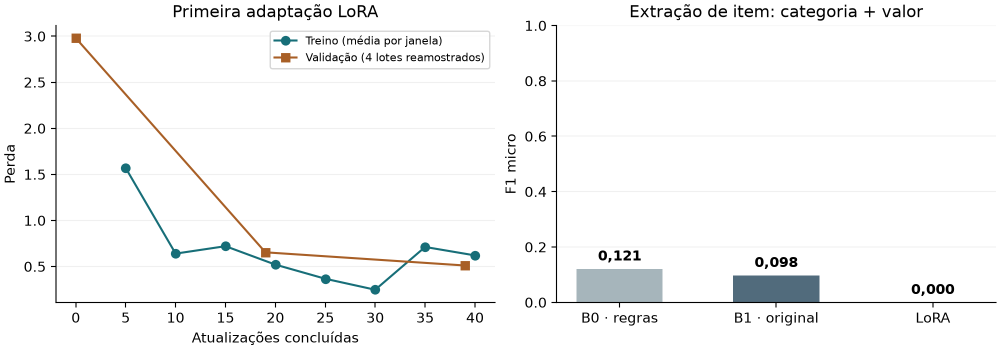
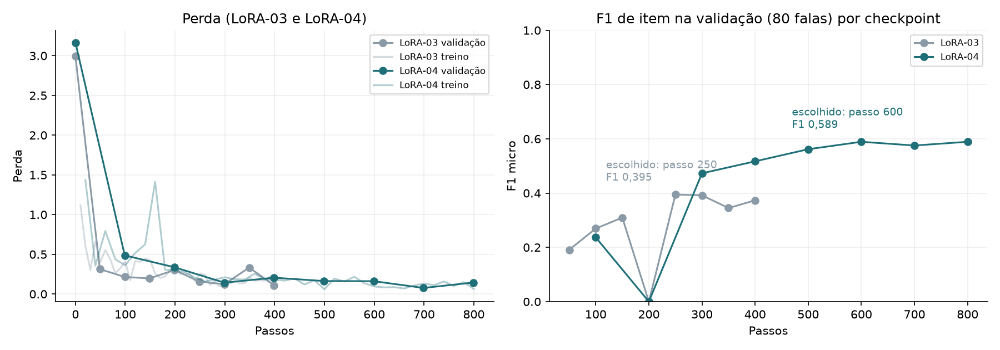

# E2 · Dados preparados e primeira adaptação

## Extrator de perguntas para feedback educacional de anamnese

**Disciplina:** Tópicos Avançados em Inteligência Artificial · 2026.2  
**Professor:** Marcondes Ricarte  
**Grupo:** G04 · **Integrantes:** Leonardo Marcelo e André Lucas  
**Execução local:** 03/11/2026 (LoRA-01 e LoRA-02) e 22/11/2026 (diagnóstico, LoRA-03, LoRA-04 e teste completo)  
**Versionamento previsto:** 22/11/2026 · **Alinhamento:** 23/11/2026

## 1. Objetivo e recorte da entrega

Esta etapa implementa a preparação dos dados e a primeira adaptação de Qwen3-4B-Instruct-2507 para extrair atos de investigação das falas do entrevistador. A comparação usa uma baseline por regras, o modelo original e o modelo com adaptador LoRA. As entradas e os rótulos de avaliação são os mesmos para os três sistemas.

O experimento é um piloto textual em inglês. Não inclui áudio e transcrição, aplicação, tradução para o português (hipótese D10 da E1), avaliação de omissões por caso ou avaliação humana do feedback. Esses componentes dependem das próximas etapas. A entrega inicial exigida pelo enunciado permite uma execução pequena; por isso, o relatório distingue o corpus preparado do subconjunto efetivamente utilizado no treino.

**Resumo dos resultados.** A primeira adaptação (LoRA-02, 40 passos) respondeu lista vazia em todas as falas. A investigação da seção 6.5 isolou a causa, e a correção (mais passos e escolha do checkpoint pela extração na validação) produziu o LoRA-04. Na partição de teste completa, com 1.014 falas, o LoRA-04 obteve F1 de item 0,634 e acerto exato por fala de 56,3%, contra 0,182 e 14,5% da baseline por regras. O resultado do modelo original (B1) na partição de teste completa está em execução e será acrescentado; no holdout de 24 falas, o B1 obteve F1 de item 0,098 e o LoRA-04, 0,683.

A tarefa é inspirada no CMAS do MediTOD. Ela não reproduz a NLU publicada no artigo-base, que avalia informações do paciente. As métricas abaixo são locais, baseadas em correspondência exata de rótulos, e não podem ser comparadas diretamente ao F1 0,7139 do artigo.

## 2. Origem, acesso e integridade dos dados

### 2.1 Fonte congelada

Foram adquiridos `raw_data/dialogs.json` e `raw_data/annotations.json` do repositório https://github.com/dair-iitd/MediTOD, fixando a revisão:

```text
0b7a87c3553c9056bc8371b0809811003f94b261
```

| Arquivo | Tamanho em bytes | SHA-256 |
|---|---|---|
| dialogs.json | 4.440.978 | 9d79ecaa10e8da630f9accdb52a1be9a7b9bd812b9e3d19b77579e320a4123b6 |
| annotations.json | 4.330.472 | 828a802da0c5d1c42e92ac15b0fb79b2d34c20e78c9d1c70e1b4423424982c59 |

O arquivo `evidencias/manifesto_dados.json` registra URLs, revisão, hashes, contagens, normalizações e seleção da avaliação. `evidencias/splits_dialogos.json` preserva a lista de identificadores por partição. Os dados brutos e derivados permanecem em `src/data/`, ignorado pelo Git.

### 2.2 Condições de uso e compartilhamento

Não foi identificada uma licença específica para as anotações do MediTOD no repositório ou no artigo. A licença CC0 dos diálogos de Fareez não resolve automaticamente as condições de redistribuição das anotações adicionais.

Os arquivos baixados e os adaptadores resultantes estão preservados apenas no ambiente local. O material preparado para versionamento contém código próprio, configurações, identificadores, estatísticas e logs técnicos. Não inclui os textos do corpus ou pesos derivados. Esclarecer as condições de compartilhamento desses derivados continua pendente: o pedido de autorização aos autores previsto na decisão D6 ainda não foi enviado, e não se presume autorização por finalidade acadêmica. Os pesos-base Qwen e a conversão MLX utilizada informam licença Apache-2.0.

## 3. Preparação, limpeza e rotulagem

### 3.1 Unidade de aprendizado

Cada amostra corresponde a uma fala do entrevistador (`doctor` no corpus), acompanhada de até duas falas anteriores. O modelo recebe somente o texto e os papéis dos falantes. O alvo contém os atos `inquire` anotados naquela fala; rótulos do histórico não são fornecidos como entrada.

A preparação verifica que os conjuntos de IDs dos dois JSON coincidem, que não há identificador de fala duplicado no diálogo e que todos os `uid` anotados correspondem às falas existentes. Turnos do paciente podem fornecer contexto, mas não são usados como alvos de investigação do estudante.

Foram identificadas 11.097 falas do entrevistador e 10.070 atos `inquire` nessas falas. A fonte contém 10.082 atos dessa intenção em todos os falantes; os 12 restantes estão associados a falas do paciente e foram excluídos da tarefa. Não houve anotação humana adicional nesta execução: os alvos derivam das anotações existentes, com transformações declaradas.

### 3.2 Transformações

| Operação | Tratamento executado |
|---|---|
| Categoria | Preservar o vocabulário fechado identificado nos atos de investigação |
| Valor | Preservar texto do rótulo em inglês; normalizar espaços; valor ausente vira string vazia |
| Atributos | Selecionar campos booleanos verdadeiros terminados em `check` |
| Erro de grafia | Unificar `frquency check` em `frequency check` |
| Valores compostos | Preservar o valor composto; não inferir separação sem regra validada |
| Fala sem investigação anotada | Manter exemplo com lista vazia como alvo |
| Comprimento | Filtrar exemplos longos no piloto, em vez de cortar o alvo |
| Português e anonimização | Nenhuma tradução ou anonimização foi executada nesta etapa; o MediTOD é composto de entrevistas simuladas |

A preparação preserva `where check` e `location check` como rótulos distintos nesta rodada. Não agrega categorias por inferência clínica. Essas escolhas favorecem rastreabilidade à anotação, mas podem penalizar respostas semanticamente próximas na métrica exata.

### 3.3 Duplicatas e prevenção de vazamento

A inspeção encontrou 18 pares de diálogos com texto integral idêntico e identificadores diferentes. Portanto, os 231 IDs representam 213 sequências textuais distintas. Uma divisão apenas por ID colocava cópias da mesma entrevista em treino e teste; essa divisão foi descartada antes da execução dos modelos de linguagem.

A divisão final agrupa cada sequência ordenada de pares `(speaker, text)` por SHA-256 e mantém todas as cópias na mesma partição. Os grupos são embaralhados com semente 42. Aproximadamente 80% ficam no treino e 10% em cada uma das outras partições. Como alguns grupos contêm dois IDs, as proporções de IDs não são exatamente 80/10/10.

| Partição | Grupos textuais únicos | IDs de diálogo | Falas do entrevistador |
|---|---|---|---|
| Treino | 171 | 186 | 8.940 |
| Validação | 21 | 24 | 1.143 |
| Teste | 21 | 21 | 1.014 |
| Total | 213 | 231 | 11.097 |

Não há grupo de diálogo integral compartilhado entre as partições. Perguntas genéricas e saudações ainda podem repetir-se em entrevistas diferentes; isso não significa que toda frase do teste seja linguisticamente inédita. A revisão encontrou 15 entradas idênticas ao treino no teste completo, considerando fala atual e duas falas de contexto, mas nenhuma delas pertence às 24 amostras selecionadas para esta avaliação. Os IDs duplicados foram agrupados, não eliminados; assim, as contagens de falas não representam observações independentes em todos os casos.

### 3.4 Piloto de treinamento e avaliação retida

O corpus completo foi preparado, mas o piloto selecionou 256 amostras de treino e 16 de validação. A seleção considera o tamanho tokenizado da sequência completa, incluindo instrução, contexto, saída supervisionada e marcadores do modelo. A seleção inicial, com semente 42, excluiu 33 exemplos longos do treino e 5 da validação. Após a correção do template descrita na seção 7, os mesmos IDs foram mantidos: seus comprimentos máximos são 491 e 407 tokens, abaixo do limite de 512. Com o template corrigido, 31 exemplos do universo de treino e 5 do de validação excedem esse limite; os dois exemplos que passaram a caber não foram acrescentados ao piloto.

O conjunto de avaliação contém 24 amostras dos diálogos de teste: 4 sem ato, 8 com atributo e 12 com investigação sem atributo. Essa composição foi fixada antes da comparação final. Ela favorece a inspeção de tipos diferentes de erro e não estima, sem viés de amostragem, a frequência de erros em todo o corpus. As amostras de avaliação não são usadas em treino nem em cálculo da perda de validação.

`evidencias/manifesto_piloto.json` registra IDs selecionados, limites e hashes dos arquivos utilizados. A preparação dos 8.940 exemplos de treino não significa que todos foram usados: a execução inicial tem apenas 40 passos com lote 1, sem uma época completa sequer sobre os 256 exemplos selecionados.

Na correção (seção 6.6), o LoRA-04 sorteou com semente 42 1.000 exemplos de treino (127 com alvo vazio, 12,7%) e 32 de validação para a perda, com o mesmo limite de 512 tokens (`evidencias/lora04/manifesto_piloto.json`). A escolha do checkpoint usa outra amostra fixa de 80 falas da validação, com a distribuição natural (9 sem ato) e sem as falas da perda (`evidencias/lora04/selecao_checkpoint.json`). A comparação final usa a **partição de teste inteira**, 1.014 falas de 21 diálogos, que não participou de nenhuma escolha.

## 4. Modelo, ambiente e configuração

### 4.1 Origem dos pesos

| Campo | Valor |
|---|---|
| Modelo original | Qwen/Qwen3-4B-Instruct-2507 |
| Conversão utilizada | mlx-community/Qwen3-4B-Instruct-2507-4bit |
| Revisão da conversão | 50d427756c6b1b2fe0c0a10f67fbda1fc8e82c1b |
| Hardware | Apple M5, arm64, 16 GiB de memória |
| Ambiente | Python 3.12 em ambiente isolado; MLX/Metal |
| Adaptação | LoRA sobre os pesos-base em quatro bits, congelados (camadas na seção 4.2) |

As fichas dos modelos estão em https://huggingface.co/Qwen/Qwen3-4B-Instruct-2507 e https://huggingface.co/mlx-community/Qwen3-4B-Instruct-2507-4bit. Os hashes locais e as versões efetivamente usadas constam no manifesto de execução. A quantização foi obtida da conversão comunitária; não foi produzida localmente nesta etapa.

O template de conversa da conversão comunitária foi substituído pelo template oficial da variante Instruct, revisão `cdbee75f17c01a7cc42f958dc650907174af0554`. A origem e o hash estão em `evidencias/template_fonte.json`; o arquivo utilizado é `src/configs/chat_template_oficial.jinja`. A correção elimina marcadores de raciocínio que o template comunitário acrescentava aos alvos, em desacordo com o contrato de JSON puro. Ela é aplicada tanto ao treino quanto à inferência, mantendo o parser estrito.

### 4.2 Hiperparâmetros

| Parâmetro | LoRA-02 (primeira adaptação) | LoRA-03 (correção mínima) | LoRA-04 (correção final) |
|---|---|---|---|
| Arquivo | `src/configs/lora_piloto.yaml` | `src/configs/lora03.yaml` | `src/configs/lora04.yaml` |
| Exemplos de treino / validação da perda | 256 / 16 | os mesmos 256 / 16 | 1.000 / 32 |
| Passos (lote 1) | 40 | 400 | 800 |
| Camadas adaptadas | últimas 4 | últimas 4 | últimas 16 |
| Módulos | `q`, `k`, `v`, `o`, `gate`, `up`, `down` | idem | idem, declarados no YAML |
| Parâmetros treináveis | 1.835.008 (0,046%) | 1.835.008 (0,046%) | 14.680.064 (0,365%) |
| Rank / scale MLX / dropout | 8 / 16,0 / 0,0 | 8 / 16,0 / 0,0 | 16 / 10,0 / 0,05 |
| Taxa de aprendizado | 0,0001 constante | 0,0001 constante | 0,0001, aquecimento de 50 passos e decaimento cosseno até 0,000001 |
| Checkpoints | 20 e 40; usado o último | a cada 50; escolhido pela validação | a cada 100; escolhido pela validação |

Comum às três: otimizador Adam, máximo de 512 tokens, máscara do prompt (só a resposta entra na perda), gradient checkpointing, semente 42 e decodificação com temperatura 0 e limite de 192 tokens, igual para B1 e LoRA. O scale é o parâmetro da implementação MLX, não chamado de alpha neste relatório.

O LoRA-03 muda uma única variável em relação ao LoRA-02 (o número de passos) para testar a causa raiz. O LoRA-04 segue a receita sugerida na revisão da E1: mais dados, mais camadas, rank maior e aquecimento da taxa de aprendizado. Não houve busca em grade nem escolha baseada no teste. Uma perda menor, isoladamente, não demonstra melhora de extração nem utilidade pedagógica.

## 5. Baselines e protocolo de métricas

### 5.1 Sistemas comparados

**B0, regras:** dicionário construído somente a partir dos valores dos rótulos de treino, com busca de termos na pergunta atual e padrões simples para alguns atributos. Não usa rótulos do teste. É uma referência de busca textual limitada, não um avaliador semiológico.

**B1, modelo original:** mesmo Qwen quantizado, sem adaptador. Recebe a instrução, vocabulário de categorias e atributos, histórico e pergunta atual. Não recebe exemplos rotulados no prompt.

**LoRA, modelo adaptado:** mesmo modelo-base e mesmo prompt, com os adaptadores da primeira execução. O código carrega os pesos localmente e valida a resposta sem acrescentar reparos específicos a uma variante.

### 5.2 Unidades comparadas

A avaliação compara conjuntos por fala, com normalização de espaços e caixa de texto nos valores. As três unidades são:

1. Ato completo: `(categoria, valor, conjunto de atributos)`.
2. Item: `(categoria, valor)`.
3. Atributo: `(categoria, valor, atributo)`.

Para cada unidade, TP é uma unidade presente no alvo e na previsão, FP aparece apenas na previsão e FN aparece apenas no alvo. A agregação micro soma essas contagens antes de calcular precisão, recall e F1. Sinônimos clínicos não recebem equivalência automática. Uma resposta semanticamente aceitável pode ser penalizada por diferença lexical; os resultados devem ser lidos com esse limite.

```text
precisão = TP / (TP + FP)
recall   = TP / (TP + FN)
F1       = 2 × precisão × recall / (precisão + recall)
```

Divisões sem denominador recebem zero por convenção explícita. A acurácia exata por turno exige igualdade de todos os atos daquela fala, incluindo exemplos sem atos. A taxa de JSON válido exige tanto sintaxe válida quanto conformidade com as categorias e os tipos do esquema.

Uma saída inválida fica registrada como erro, não como uma previsão válida de lista vazia. Ela produz falsos negativos para os atos esperados e falha nas métricas de validade e de acerto exato. Se o alvo estiver vazio, não existe ato para contar como FN; por isso, F1 deve ser apresentado junto com validade e acurácia exata, evitando esconder falhas de formato.

## 6. Resultados medidos

### 6.1 Execução registrada da primeira adaptação (LoRA-02)

O treinamento terminou com código de saída zero e 40 passos. A primeira e a última perdas de treino reportadas foram 1,569 e 0,620. As perdas de validação inicial e da última leitura foram 2,980 e 0,510. As janelas de treino contêm exemplos diferentes; a curva não representa a avaliação repetida de um conjunto fixo de treinamento. A última validação ocorreu após 39 atualizações, antes da última atualização do adaptador. Cada avaliação sorteia quatro lotes dentre os 16 exemplos de validação; a composição pode mudar, portanto a variação da perda inclui esse efeito de amostragem.

| Medida | Valor observado |
|---|---|
| Duração do processo registrado, incluindo instrumentação | 22,27 s |
| Pico RSS do processo filho, amostrado a cada 0,2 s | 2,36 GiB |
| Pico de alocação MLX informado nos eventos | 3,30 GB decimais |
| Python | 3.12.13 |
| MLX / MLX-LM | 0.32.4 / 0.32.2 |

RSS e memória alocada pelo MLX medem coisas diferentes e não devem ser somados. O RSS amostrado pode deixar de capturar um pico entre duas leituras. Os tempos de download e preparação anterior ao início do processo não estão incluídos.

### 6.2 Primeira comparação no holdout de 24 falas

| Sistema | F1 ato | F1 item | F1 atributo | JSON válido | Acerto exato | s/fala |
|---|---|---|---|---|---|---|
| B0 · regras | 0,061 | 0,121 | 0,167 | 100,0% | 12,5% | 0,001 |
| B1 · original | 0,000 | 0,098 | 0,000 | 75,0% | 8,3% | 1,412 |
| LoRA-02 | 0,000 | 0,000 | 0,000 | 100,0% | 16,7% | 0,324 |

A latência é a média por fala, sem o carregamento inicial dos pesos. A amostra contém 24 falas de 13 diálogos, com 20 atos de referência e 10 atributos. B0 constrói seu dicionário com todos os rótulos de treino; LoRA utiliza o piloto. O orçamento de supervisão de B0 e LoRA não é equalizado.

| Sistema | TP / FP / FN de ato | Precisão de ato | Recall de ato | Macro-F1 de item |
|---|---|---|---|---|
| B0 | 1 / 12 / 19 | 0,077 | 0,050 | 0,033 |
| B1 | 0 / 21 / 20 | 0,000 | 0,000 | 0,098 |
| LoRA-02 | 0 / 0 / 20 | 0,000 | 0,000 | 0,000 |

O macro-F1 usa as mesmas seis categorias presentes na referência para todos os sistemas. Categorias sem suporte no holdout não são avaliadas por essa média.

O F1 de ato permaneceu igual após o ajuste. A diferença LoRA menos B1 foi 0,000; para F1 de item, a diferença foi -0,098. Trata-se de uma diferença observada neste piloto; não foi feito teste de significância e não se demonstrou generalização ou eficácia pedagógica.

Na rodada inicial arquivada, o tempo total de B1 incluiu espera pelo download. Na comparação atual, a tabela utiliza somente a latência individual de geração por fala, medida depois do carregamento; não compara download com inferência.



### 6.3 Rastreabilidade dos resultados

Os números foram lidos de `metricas_b0.json`, `metricas_b1.json`, `metricas_lora.json` e `execucao_treino.json`, que registram o hash do holdout, das previsões, do log, dos eventos e dos adaptadores. `src/configs/registrar_proveniencia.py` confere esses vínculos. Previsões individuais e saídas brutas ficam no diretório local `src/artifacts/`, permitindo inspecionar os erros sem publicar textos do corpus.

A curva e as métricas demonstram uma execução real. O tamanho da amostra, os erros observados e a correspondência lexical exata não permitem concluir que o sistema esteja pronto para avaliar estudantes.

### 6.4 Análise dos erros da primeira adaptação

Na rodada corrigida, o adaptador retornou lista vazia em todas as 24 falas. O formato passou a ser válido, mas as 20 referências positivas não foram recuperadas. Os quatro acertos exatos correspondem apenas às quatro falas cujo alvo era vazio. Assim, a melhora de validade, de 75% no modelo original para 100% no adaptado, não representa melhora de extração.

O F1 de item caiu de aproximadamente 0,098 em B1 para zero com LoRA. A baseline por regras obteve aproximadamente 0,121. A latência menor do adaptador também não é vantagem útil: produzir apenas uma lista vazia exige menos tokens do que tentar identificar os atos. O resultado desta primeira adaptação é negativo para a qualidade da tarefa, apesar de o pipeline de treinamento e avaliação ter sido executado.

O comportamento observado é uma concentração das previsões na saída vazia. Ele não foi introduzido pela correção do template: na primeira rodada, as 24 respostas também continham `[]` depois do bloco de raciocínio que o parser rejeitou. Também não se explica por desbalanceamento dos alvos, pois só 37 dos 256 exemplos de treino do piloto (14%) têm lista vazia. A investigação está na seção 6.5.

### 6.5 Diagnóstico do colapso para lista vazia

A investigação mudou uma variável por vez. Os números e scripts estão em `evidencias/diagnostico_colapso/`.

1. **Reprodução.** O LoRA-02 reavaliado repetiu as 24 saídas. Retreinado com a mesma configuração, gerou curvas de perda quase iguais (validação 2,992 → 0,533, contra 2,980 → 0,510) e o mesmo colapso.
2. **Primeiro token.** Uma lista vazia é um único token, `[]`; uma lista com atos começa pelo token `[`. Nas falas com pergunta do holdout, o modelo original dá probabilidade 0,999 a `[` e 0,000 a `[]`. Após 20 passos, `[]` já tinha 0,534; após 40, 0,962, inclusive nos 35 exemplos de treino com pergunta que o modelo viu.
3. **Separação.** Numa amostra de 120 falas da validação, o LoRA-02 ainda ordena falas com e sem pergunta (AUC 0,85, contra 0,89 do original), mas atribui mais de 0,95 a `[]` em ambas. O problema é um deslocamento global da decisão, não perda da informação.
4. **Sem alvos vazios (mesmos 40 passos):** o colapso some; `[]` cai para 0,002 nas falas com pergunta.
5. **Com alvos vazios e 400 passos:** respostas vazias indevidas caem para 3%.

**Causa raiz.** Os poucos exemplos vazios geram gradientes grandes no primeiro token, porque o modelo original quase nunca escolhe `[]` e esse token é um terço da perda desses exemplos. Os exemplos com pergunta quase não geram gradiente ali, porque `[` já tinha probabilidade 0,999. A decisão inteira se desloca para `[]`. Com taxa constante e 40 passos, o treino parou no pico desse deslocamento; com mais passos, os exemplos com pergunta o compensam. A perda média não acusa o problema: no LoRA-03, o checkpoint do passo 200 tinha perda de validação 0,303 e respondeu vazio nas 80 falas de validação (Figura 2).

### 6.6 Correção: mais passos e escolha do checkpoint pela validação

A correção tem duas partes: treinar o suficiente para sair do deslocamento inicial e escolher o checkpoint pelo **F1 de extração numa amostra fixa da validação** (`src/motor/select.py`), não pela perda nem pelo último passo. O LoRA-03 aplica só isso à receita do LoRA-02. O LoRA-04 acrescenta a receita sugerida na revisão da E1 (seção 4.2).

| Rodada | F1 de item por checkpoint na validação (80 falas) | Escolhido | F1 item / ato / atributo no escolhido |
|---|---|---|---|
| LoRA-03 | 0,191 · 0,269 · 0,310 · **0,000** · 0,395 · 0,392 · 0,345 · 0,373 (passos 50 a 400) | passo 250 | 0,395 / 0,231 / 0,000 |
| LoRA-04 | 0,237 · **0,000** · 0,473 · 0,517 · 0,562 · 0,589 · 0,575 · 0,589 (passos 100 a 800) | passo 600 | 0,589 / 0,521 / 0,444 |

O valor zero no passo 200 das duas rodadas corresponde a respostas vazias nas 80 falas: o deslocamento reaparece no meio do treino. Por isso o último checkpoint ou a menor perda não são critérios seguros. O LoRA-04 levou 2.382 s de processo, incluindo as avaliações de perda, com pico RSS de 2,58 GiB e pico de alocação MLX de 3,64 GB decimais.



**Holdout de 24 falas (o mesmo da seção 6.2, diagnóstico, não cego):**

| Sistema | F1 ato | F1 item | F1 atributo | JSON válido | Acerto exato | TP / FP / FN de ato | s/fala |
|---|---|---|---|---|---|---|---|
| B0 · regras | 0,061 | 0,121 | 0,167 | 100,0% | 12,5% | 1 / 12 / 19 | 0,001 |
| B1 · original | 0,000 | 0,098 | 0,000 | 75,0% | 8,3% | 0 / 21 / 20 | 1,412 |
| LoRA-02 | 0,000 | 0,000 | 0,000 | 100,0% | 16,7% | 0 / 0 / 20 | 0,324 |
| LoRA-03 | 0,143 | 0,238 | 0,000 | 100,0% | 25,0% | 3 / 19 / 17 | 1,810 |
| LoRA-04 | 0,439 | 0,683 | 0,400 | 100,0% | 50,0% | 9 / 12 / 11 | 1,918 |

### 6.7 Resultados na partição de teste completa

A partição de teste inteira (1.014 falas, 877 com pergunta e 137 sem) não participou de treino, seleção de checkpoint nem diagnóstico. Arquivos em `evidencias/teste_completo/`.

| Sistema | F1 ato | F1 item | F1 atributo | Precisão / recall de item | JSON válido | Acerto exato | Macro-F1 de item | s/fala |
|---|---|---|---|---|---|---|---|---|
| B0 · regras | 0,134 | 0,182 | 0,070 | 0,194 / 0,172 | 100,0% | 14,5% | 0,069 | 0,001 |
| B1 · original | em execução | | | | | | | |
| LoRA-04 | 0,521 | 0,634 | 0,372 | 0,642 / 0,628 | 99,5% | 56,3% | 0,515 | 1,887 |

O macro-F1 usa as 13 categorias com suporte no teste. F1 de item do LoRA-04 por categoria, com o número de itens de referência entre parênteses: `symptom` 0,648 (498), `medical history` 0,532 (131), `habit` 0,790 (76), `medication` 0,571 (47), `family history` 0,581 (46), `exposure` 0,667 (41), `residence` 0,745 (22), `symptom (dermatology)` 0,400 (20), `travel` 0,850 (19), `occupation` 0,909 (6), `medical test` 0,000 (9), `other` 0,000 (5), `basic information` 0,000 (1). Categorias com menos de 10 itens não permitem conclusão.

**Análise dos erros do LoRA-04 no teste.**
- **Falas sem pergunta:** ele atribuiu alguma investigação a 36 das 137 (26%). No feedback, isso viraria um elogio indevido.
- **Falas com pergunta:** respondeu vazio em só 8 das 877 (0,9%). O colapso foi corrigido.
- **Formato:** 5 saídas inválidas (0,5%).
- **Atributos:** continuam sendo o ponto mais fraco (F1 0,372). O modelo identifica o assunto da pergunta com mais frequência do que o aspecto investigado.
- **Comparação exata:** variações de valor como `marijuana vape` × `marijuana` contam como erro.

Os resultados são de um único treino por configuração, sem teste de significância e sem intervalo de confiança. Medem correspondência com os rótulos do MediTOD em inglês; não medem omissão clínica nem efeito pedagógico.

## 7. Obstáculos e limites de interpretação

A preparação revelou cópias integrais de diálogos com IDs diferentes. O agrupamento por conteúdo corrigiu o vazamento da primeira divisão antes do treino e da comparação final. O download inicial via Xet também apresentou interrupção de progresso; a aquisição foi retomada por HTTP, mantendo a revisão fixa e a verificação de integridade.

Uma primeira rodada de 40 atualizações foi concluída, mas seu adaptador produziu zero respostas válidas nas 24 amostras. A investigação encontrou a causa da invalidez no template comunitário: ele inseria um bloco vazio de raciocínio antes do JSON no texto efetivamente supervisionado. O modelo aprendeu esse formato e o parser o rejeitou. Depois do bloco, as 24 respostas eram `[]`. A perda de validação havia caído, demonstrando por que a curva, sozinha, não comprovava sucesso da extração.

Essa rodada foi preservada em `evidencias/experimento_01_template_original/`, com seus pesos e previsões em `src/artifacts/experimento_01_template_original/`. A correção usa o template oficial e inclui uma regressão sobre a continuação realmente tokenizada, não apenas sobre o campo textual das mensagens. Todos os 272 alvos do piloto corrigido foram conferidos quanto ao formato JSON. Os IDs dos 256 exemplos de treino e dos 16 de validação foram mantidos, assim como os 40 passos e demais hiperparâmetros.

Os resultados das seções 6.1 a 6.4 correspondem à rodada com o template corrigido (LoRA-02). O mesmo holdout foi reutilizado após a inspeção necessária ao diagnóstico; portanto, esta avaliação não deve ser descrita como teste cego. Não houve ajuste de hiperparâmetros para buscar ganho no holdout. A correção remove uma inconsistência de software, e uma avaliação futura independente será necessária para sustentar conclusões de generalização.

A rodada corrigida do template (LoRA-02) colapsou para lista vazia. A causa foi isolada (seção 6.5) e corrigida com mais passos e escolha do checkpoint pela validação (seção 6.6). O deslocamento para `[]` reaparece no meio do treino (passo 200 nas duas rodadas), então a seleção pela validação é parte necessária da receita, não um detalhe.

O holdout de 24 falas é pequeno e estratificado: não representa a distribuição de uso. Por isso a comparação final usa a partição de teste completa. Ainda assim, ela vem do mesmo corpus simulado e em inglês, e um único treino por configuração não estima a variação entre execuções. Não se pode concluir que o modelo funciona para todas as perguntas, especialidades, estudantes ou situações de entrevista.

O ajuste e a avaliação são em inglês, os rótulos provêm do corpus e os valores não passaram por revisão clínica da dupla ou da cliente nesta execução. As métricas medem correspondência com esses rótulos. Elas não validam o roteiro pedagógico, não medem omissões clínicas e não demonstram efeito no aprendizado. A tradução para português e a avaliação de áudio continuam fora desta entrega.

Os dados e adaptadores permanecem locais por pendência das condições de redistribuição das anotações. Os manifestos e instruções permitem conferir a execução e reconstruí-la, mas não devem ser apresentados como licença de terceiros ou aprovação de compartilhamento.

## 8. Continuidade proposta até E3

| Ação | Evidência esperada | Motivo |
|---|---|---|
| Baseline few-shot (3 a 5 exemplos do treino no prompt) | Métricas na mesma partição de teste | Comparação mais exigente para justificar o ajuste |
| Traduzir a partição de teste para o português e medir a perda (D10) | Tradução registrada, amostra revisada e métricas | O cenário da cliente é em português |
| Reduzir investigações atribuídas a falas sem pergunta (26% no teste) | Taxa medida na validação e no teste | Evitar elogio indevido no feedback |
| Melhorar atributos (F1 0,372) | F1 de atributo por tipo na validação | O feedback depende do aspecto investigado |
| Analisar manualmente 30 a 50 erros do LoRA-04 | Classificação dos erros por tipo | Orientar a próxima rodada |
| Repetir o treino com outras sementes | Média e variação das métricas | Estimar a estabilidade do resultado |
| Integrar transcrição (Whisper), extração e feedback | Fluxo executável a partir do áudio simulado | Escopo da E3 |
| Revisar o roteiro com a cliente e esclarecer a licença das anotações | Registro de itens e condição de compartilhamento | Antes do uso educacional e de redistribuir adaptadores |

Toda nova rodada recebe identificação, configuração e métricas próprias, preservando os registros atuais.

## 9. Reprodução, artefatos e material de alinhamento

O ponto de entrada técnico é `src/README.md`. Os modelos de linguagem dependem de Apple Silicon e Metal nesta implementação; isso não constitui suporte testado a Windows, Linux ou CUDA.

| Artefato | Finalidade |
|---|---|
| `src/motor/data.py` | Aquisição e preparação com validação dos dados |
| `src/motor/model.py` | Prompt, parser e carregamento do modelo |
| `src/motor/train.py` | Seleção do piloto e execução do LoRA |
| `src/motor/evaluate.py` | Baselines e cálculo das métricas, com adaptador, conjunto de falas e pasta de saída configuráveis |
| `src/motor/select.py` | Escolha do checkpoint pela extração na validação |
| `src/configs/lora_piloto.yaml`, `lora03.yaml`, `lora04.yaml` | Hiperparâmetros de cada rodada |
| `src/configs/chat_template_oficial.jinja` e `piloto_ids.json` | Template corrigido e exemplos fixados entre as rodadas |
| `src/configs/registrar_proveniencia.py` | Vincular métricas, modelo e adaptador por hash após as avaliações |
| `src/requirements-ml.txt` | Dependências resolvidas |
| `evidencias/manifesto_dados.json` | Fonte, hashes, contagens e divisão |
| `evidencias/manifesto_piloto.json` | Exemplos e comprimentos usados no piloto |
| `evidencias/execucao_treino.json` e `treinamento.log` | Ambiente, execução, perdas, duração e adaptadores |
| `evidencias/metricas_b0.json`, `metricas_b1.json`, `metricas_lora.json` | Métricas do holdout (B0, B1, LoRA-02) |
| `evidencias/diagnostico_colapso/` | Investigação do colapso para lista vazia |
| `evidencias/lora03/`, `evidencias/lora04/` | Execução, seleção de checkpoint e métricas do holdout de cada rodada |
| `evidencias/teste_completo/` | Métricas na partição de teste inteira |
| `src/artifacts/lora_piloto/`, `lora03/`, `lora04/` | Adaptadores locais; ignorados pelo Git |
| `src/artifacts/predictions_*.jsonl` | Previsões e erros por amostra; arquivos locais |
| `evidencias/revisao_tecnica.md` | Conferência independente de dados e avaliação |

## 10. Matriz de atendimento da E2

| Exigência do enunciado | Material |
|---|---|
| Limpeza, rotulagem e pré-processamento | Seção 3; código e manifesto |
| Partições justificadas | Seção 3.3; IDs e grupos de conteúdo |
| Baseline comparável | Seção 5; B0 e B1 nas mesmas falas e condições (seções 6.2, 6.6 e 6.7) |
| Primeiro fine-tuning e hiperparâmetros | Seções 4 e 6; configurações, logs, curvas e adaptadores locais |
| Ambiente e evidências de execução | Manifesto de execução e instruções |
| Resultados sem estimativas apresentadas como medições | Seção 6, vinculada aos JSON e logs |
| Obstáculos e plano de correção | Seções 6.5, 7 e 8 |
| Pesos ou adaptadores e condições de acesso | Diretório local e restrição de redistribuição explicitada |

## 11. Referências principais

Saley, V. V. et al. (2024). MediTOD: An English Dialogue Dataset for Medical History Taking with Comprehensive Annotations. EMNLP. https://doi.org/10.18653/v1/2024.emnlp-main.936

Hu, E. J. et al. (2022). LoRA: Low-Rank Adaptation of Large Language Models. ICLR. https://arxiv.org/abs/2106.09685

Dettmers, T. et al. (2023). QLoRA: Efficient Finetuning of Quantized LLMs. NeurIPS. https://arxiv.org/abs/2305.14314

Qwen Team. (2025). Qwen3 Technical Report. https://arxiv.org/abs/2505.09388. Modelo: https://huggingface.co/Qwen/Qwen3-4B-Instruct-2507

MLX-LM. Documentação de LoRA, parâmetros e execução. https://github.com/ml-explore/mlx-lm/blob/main/mlx_lm/LORA.md

A fundamentação educacional, a evidência da cliente e as condições das fontes estão na E1 (`docs/E1-definicao.md`) e em `referencias.bib`, na raiz do repositório.
